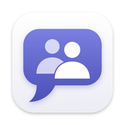
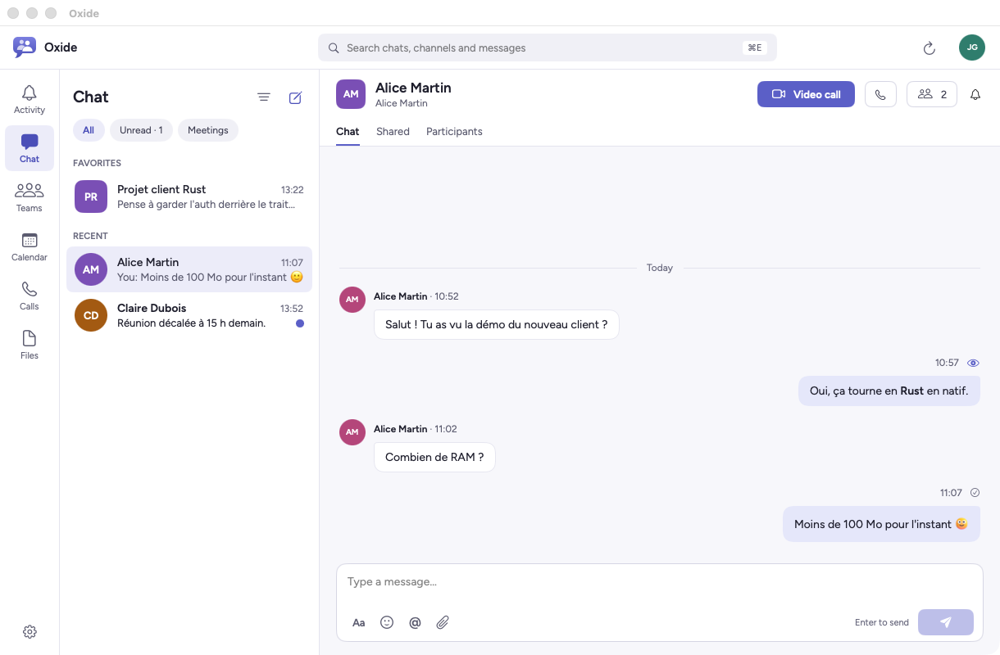

<div align="center">



# Oxide

**An unofficial native Mac client for Microsoft Teams.**
SwiftUI interface, Rust core, no embedded browser.


[](LICENSE)

</div>

<p align="center">
  
  <br>
</p>

> [!WARNING]
> Oxide is an **independent, unofficial** project with no affiliation to Microsoft.
> It talks to Teams services through a protocol reconstructed from the web client, and signs in
> with the application ID of Microsoft's own web client, which is not meant for third-party
> clients. It may stop working at any time, and using it may go against your organization's
> policies. Use it at your own risk.

## Why

The official Teams client is a packaged web app. Oxide uses the same services from a real Mac
app: fast startup, low memory use, keyboard shortcuts, system notifications and Keychain,
light and dark themes.

<picture align="center">
  <source media="(prefers-color-scheme: dark)" srcset="assets/oxide-dark.png">
  
</picture>

## Features

**Chats and teams**
- One-on-one and group chats: create them, find people in the directory, favorites, filters.
- Teams with standard, private and shared channels, posts and reply threads.
- Create a team or a channel, join a team from the gallery or with a code, leave a team.
- Rich-text composer with Teams emojis, mentions and attachments; a draft is kept per chat.
- Reactions, editing and deleting your own messages, read receipts, typing indicator.
- Important and urgent messages (delivery options).
- Chat list: pin, hide, mark as read or unread.
- Group chats: rename, add people with or without the history, remove people, leave.
- GIFs (Giphy) and Teams stickers.
- Bot cards with inputs and buttons (`Action.Submit`, `Action.Execute`).
- Images and shared files shown inline in the conversation.
- Message search on the server, filtered by sender, date, place, attachments and mentions.

**Calls and meetings**
- Audio and video calls, one-on-one or in groups, started from a chat or from the call history.
- Meetings: pre-join screen, lobby, participant list.
- Incoming calls with ringtone and notification; missed calls.
- Screen sharing; choice of microphone, speaker and camera.
- Call history and voicemail.
- Test call with the Teams Echo Bot, with a report on the microphone, sound, camera and network.

**Calendar**
- Day, week and month views.
- Create and edit events and Teams meetings, respond to invitations.
- Recurring meetings: presets and custom rules, one occurrence or the whole series.

**Activity and notifications**
- Messages arrive in real time.
- Activity feed.
- macOS banners with quick reply, and an unread badge on the Dock icon.
- Notification settings per chat and per channel.
- Your status, status message and automatic replies (out of office).

**A real Mac app**
- Shortcuts: <kbd>⌘1</kbd> to <kbd>⌘6</kbd> to navigate, <kbd>⌘N</kbd> for a new chat, <kbd>⌘E</kbd> to search, <kbd>⌘R</kbd> to refresh.
- Session kept in the Keychain and renewed in the background.
- Light, dark or system theme.
- Interface in English or French.

## Installation

### Prebuilt app

Download `Oxide-<version>.zip` from the [releases](https://github.com/neicureuil/oxide/releases),
unzip it and move `Oxide.app` to `/Applications`. It needs macOS 14 Sonoma or later on Apple silicon,
and updates itself from then on.

The app is not notarized, so macOS blocks its first launch: allow it in
System Settings › Privacy & Security, or run `xattr -dr com.apple.quarantine /Applications/Oxide.app`.

### From source

**Requirements**
- macOS 14 Sonoma or later.
- Xcode 16 or later, for Swift 6.
- Rust 1.85 or later ([rustup](https://rustup.rs)).

**Build**

```sh
git clone <repository-url> oxide
cd oxide
./scripts/build-app.sh
open target/Oxide.app
```

`build-app.sh` builds the Rust core, generates the Swift bindings, then builds and signs the app.
The signature is ad hoc by default: no certificate or team ends up in the app, but macOS asks
again for Keychain access after every build. Set `SIGN_IDENTITY` to the name of one of your
certificates to sign with it instead and keep that access across rebuilds.

### Try it without an account

A demo mode replaces Microsoft's services with sample data:

```sh
DEMO=1 ./scripts/build-app.sh
open target/Oxide.app --args --demo
```

Regular builds do not include the demo server and ignore `--demo`.

## Architecture

```text
apps/macos/            SwiftUI and AppKit app: screens, calls (WebRTC), notifications
crates/
  teams-core/          App state and view models, exposed to Swift through UniFFI
  teams-auth/          Microsoft sign-in: OAuth PKCE, authz, per-service tokens
  teams-chat/          Chats, channels, messages (chat service and CSA)
  teams-realtime/      Trouter push channel and notification registration
  teams-calling/       Call and meeting signalling, call history, voicemail
  teams-calendar/      Microsoft 365 calendar
  teams-files/         OneDrive and SharePoint files
  teams-i18n/          Language of the messages shown on screen
  teams-probe/         Command-line tool to exercise the services
scripts/               Builds of the core, the app and the icon
```

The Rust core holds all of the app's state. Swift sends it actions and receives only the
parts of the screen that changed. Networking, tokens and business logic stay in Rust. Swift
handles the display and everything specific to macOS: WebKit for sign-in, WebRTC for audio
and video, system notifications.

## Sign-in and security

- "Sign in with Microsoft" opens Microsoft's sign-in page in a WebKit window. Oxide does not
  store your password.
- The refresh token is stored in the macOS Keychain. No token is written to disk in plain text.
  Access tokens stay in memory and are renewed before they expire.
- Like the web client, Oxide signs in again silently when the session expires. The sign-in
  window only comes back when Microsoft asks for an action, such as multi-factor authentication.
- Signing out removes the session from the Keychain and clears the sign-in cookies.

### Application ID

Oxide does not ship an application ID. It reads the one from the configuration that the Teams
web client loads, along with the Echo Bot used for test calls and the version of the emoji
catalog. These settings are kept in `~/Library/Caches/Oxide/web-config.json` and read again
after a week; the copy on disk still serves when Teams cannot be reached, and built-in values
replace the Echo Bot and emoji settings when there is no copy at all.

To use another application ID, set it in either of these places, the first one found wins:

- the `OXIDE_CLIENT_ID` environment variable;
- `~/Library/Application Support/Oxide/config.json`:

  ```json
  { "client_id": "00000000-0000-0000-0000-000000000000" }
  ```

Delete the cache file to read the settings again.

## Known limitations

- Only the public Microsoft 365 cloud is supported: no guest or anonymous accounts, no
  sovereign clouds.
- Shared channels and team templates cannot be created: they use a provisioning service
  Oxide does not call yet. Team settings (owners, permissions) stay in Teams on the web.

## Development

```sh
cargo test --workspace
cargo clippy --workspace --all-targets -- -D warnings
./scripts/build-app.sh
swift test --package-path apps/macos
```

- **Interface:** `./scripts/build-core.sh` regenerates the Rust library and the Swift bindings.
  You can then open `apps/macos/Package.swift` in Xcode.
- **Tests:** network exchanges are tested against mock servers.
- **Icon:** after editing `apps/macos/Resources/AppIcon.svg`, `./scripts/make-icon.sh`
  regenerates `AppIcon.icns`. The script needs Google Chrome.

## Contributing

Issues and pull requests are welcome. Before opening a pull request, make sure the commands in
[Development](#development) pass.

## License

Oxide is free software, released under the [GNU General Public License, version 3](LICENSE) or
any later version. You may use, study, modify and redistribute it. Any modified version you
distribute must stay under the same license, with its source code.

The Figtree font is released under the [SIL Open Font License](apps/macos/Resources/Fonts/Figtree-OFL.txt).

Microsoft and Microsoft Teams are trademarks of the Microsoft group of companies. Oxide is not
endorsed or sponsored by Microsoft.
